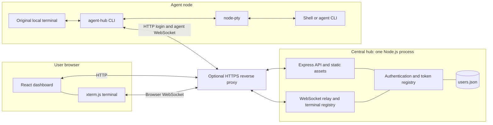
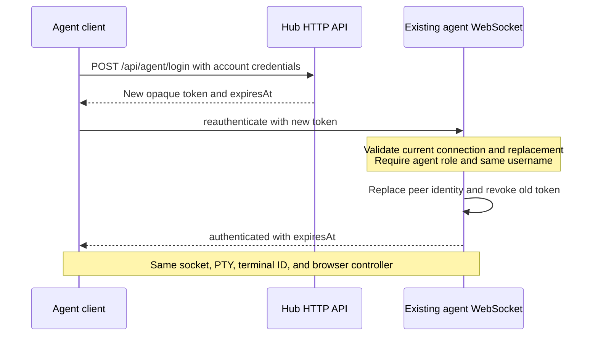

# Agent Hub architecture

This document explains the current implementation for developers and operators. See [README.md](README.md) for installation and deployment, [AGENTS.md](AGENTS.md) for AI coding-agent guidance, and [the standalone client guide](agent/README.md) for agent-node usage.

## Purpose and boundaries

Agent Hub lets a browser view and operate a shell or agent CLI running on another machine. It preserves interactive prompts, ANSI colors, control characters, and resizing by running each child inside a real pseudo-terminal (PTY), rather than capturing redirected stdout.

There are two deployable parts:

- **Central hub:** a Node.js process serving the HTTP API, WebSocket relay, and built React application.
- **Agent client:** an independently buildable Node.js CLI installed on each agent node. Each invocation launches and owns one child terminal.

The browser and client both connect to the hub. They never connect directly to each other, and the agent does not need an inbound network listener. The hub relays terminal traffic; it does not execute the node's commands locally or act as an agent-task scheduler.

## Runtime topology

The reverse proxy is optional for loopback development, but HTTPS is required for safe access over untrusted networks. In production, API, assets, and browser WebSockets share one external origin.

## Code and package boundaries

| Location | Role |
| --- | --- |
| `server\index.ts` | Service entry point and graceful shutdown. |
| `server\config.ts` | Validates environment configuration and defines service defaults. |
| `server\app.ts` | Composes Express, authentication, HTTP routes, static assets, and the relay. |
| `server\auth.ts` | User-file persistence, password verification, token issuance, expiration, and login throttling. |
| `server\users-cli.ts` | Local account creation and password reset; there is no public signup endpoint. |
| `server\hub.ts` | Owns connected peers, terminal metadata/history, ownership checks, controller selection, and message routing. |
| `agent\src\index.ts` | CLI parsing, login, PTY lifecycle, local I/O, output buffering, reconnect, and token renewal. |
| `agent\src\prompt.ts` | Hidden interactive password prompt, also reused by the hub's account-management CLI. |
| `agent\src\token.ts` | Computes proactive token-renewal timing. |
| `agent\src\protocol.ts` | Canonical message types, runtime response guards, and terminal limits. |
| `shared\protocol.ts` | Re-exports the canonical protocol for the hub and browser; does not duplicate it. |
| `web\src\App.tsx` | Login, session list, and workspace composition. |
| `web\src\useHub.ts` | Browser WebSocket lifecycle, reconnect, and subscription transport. |
| `web\src\TerminalPane.tsx` | xterm.js rendering, history replay, keyboard forwarding, resizing, and controller state. |

The root and `agent` are separate npm projects with separate lockfiles, not an npm workspace. The agent's only runtime dependencies are `node-pty` and `ws`. Its source and TypeScript configuration must not depend on files outside `agent`.

The dependency direction is intentional: the hub can reuse the agent's protocol and password-prompt source, but the standalone agent cannot import the hub. The hub TypeScript build emits those imported sources under its own `dist` tree as needed.

`npm run pack:agent` runs the agent's `prepack` build and produces a tarball containing compiled JavaScript, package metadata, and its README. It does not bundle Node.js, native dependencies, credentials, server code, or browser assets. npm installs the declared native dependencies for the target OS and architecture.

## Session and data flow

### Connect and register

1. The client reads its server address, username, and password. The password is prompted without echo or supplied through `AGENT_HUB_PASSWORD`; it is removed from the environment before launching the child.
2. `POST /api/agent/login` verifies the account and returns an agent-scoped bearer token and expiration timestamp.
3. The client opens `/ws/agent` with the token in the Authorization header, then sends `register` with terminal metadata and dimensions.
4. The hub assigns a session ID and resume token, stores the account as the terminal owner, and returns `registered` with the last accepted output sequence.
5. After registration succeeds, the client launches the requested executable in a PTY. A reconnect reuses the existing child instead of launching another.

### Output, input, and control

The client writes PTY output to its local stdout and sends numbered `output` messages to the hub. The hub retains recent output, broadcasts it to watching browsers, and acknowledges the accepted sequence with `ack`. An acknowledgment means the hub accepted output into memory, not that it was durably stored or displayed by every viewer.

A browser signs in, opens `/ws/browser`, and receives its account's terminal list. Sending `watch` returns a `snapshot` containing terminal metadata, retained output, and controller status. Subsequent `output` and `state` messages keep the display current.

The first viewer of an uncontrolled terminal gets control. Other viewers remain read-only until they send `control` to take it. Only the controlling browser can send `input` or `resize`; the hub forwards those messages to the owning agent connection. The client reports applied dimensions through `resized`. Local keyboard input remains independent of browser controller ownership.

Applied dimensions are authoritative for every browser, including the controller. The controller proposes a viewport fit, clamped to protocol limits, when its container changes, it gains control, or the agent comes back online. The renderer adopts the size reported by the agent rather than an unacknowledged fit; read-only viewers retain that shared geometry instead of independently rewrapping output. Retained session statuses are marked unknown while the browser's hub connection is unavailable.

Closing a browser detaches its viewer without stopping the child. Exiting the child reports `exit`, transitions the terminal to `exited`, and propagates the child's exit code through the wrapper after output delivery. Stopping the wrapper stops its child; there is no facility to adopt a pre-existing terminal.

### Proactive token renewal

Tokens normally live for 12 hours. The client schedules renewal one minute before expiration, or after 80% of the remaining lifetime when less than five minutes remain.

Renewal uses the retained account credentials; it is not a separate refresh-token grant. Temporary failures are logged and retried with bounded backoff while the original token remains valid. Missing confirmation or expiration falls back to the ordinary reconnect flow. Both hub and client must support the renewal protocol.

### Disconnections and restart

The client reconnects with exponential backoff capped at 15 seconds. For a retained terminal, the same username, session ID, and resume token allow it to resume after the old agent connection has been released. Sequence acknowledgments let the client discard accepted output and retransmit unacknowledged output without duplication.

While disconnected, the client buffers output and pauses PTY reads when the queue fills. Browser input is disabled while its connection is offline. Input is not queued for replay: repeating terminal commands after reconnect would be unsafe, and in-flight keystrokes are not guaranteed to be delivered.

A hub restart loses authentication sessions, terminal registrations, and output history. A still-running wrapper reauthenticates and registers its existing child as a new terminal. Previously acknowledged output cannot be recovered, and browsers must sign in again.

## HTTP and WebSocket interfaces

| Interface | Purpose and authentication |
| --- | --- |
| `GET /api/health` | Public liveness response. |
| `POST /api/login` | Browser account login; same-origin request; sets a session cookie. |
| `POST /api/agent/login` | Client account login; returns an agent bearer token. |
| `POST /api/logout` | Same-origin browser logout; revokes its token and sockets. |
| `GET /api/me` | Current browser identity; browser cookie required. |
| `GET /api/sessions` | Account-owned terminal metadata; browser cookie required. |
| `/ws/browser` | Authenticated browser events and controls; cookie and allowed Origin required. |
| `/ws/agent` | Authenticated PTY transport; agent bearer token required. |

WebSocket payloads are JSON text messages. TypeScript types alone are not trusted at runtime: the hub validates incoming message fields, and client/browser guards validate received messages.

## Authentication and trust boundaries

Passwords are stored as independently salted scrypt hashes in `users.json`, with timing-safe verification. User-file updates use a lock and atomic replacement. Browser sessions use HttpOnly, SameSite=Strict cookies, with Secure enabled for an HTTPS public origin.

Bearer tokens are **opaque 256-bit random values, not signed JWTs**. The hub indexes SHA-256 token hashes in memory alongside username, role, and expiration. Browser tokens cannot authenticate agent sockets, and agent tokens cannot authenticate browser sockets. Every terminal access is scoped to its owner.

The service enforces browser-origin validation, login throttling, bounded concurrent password derivation, message limits, and socket limits. It does not use forwarded host/IP headers to relax these checks. Behind a reverse proxy, login throttling sees the direct proxy peer address.

The hub is trusted with credentials and terminal contents. HTTPS protects the transport; it does not provide end-to-end encryption that hides output from the hub. The child runs with the agent user's operating-system privileges and is **not sandboxed**.

There are no default credentials. Password resets affect subsequent login, but restarting the hub is required to invalidate already-issued sessions. Logging out a browser does not revoke independent agent logins.

## State, limits, and persistence

| State | Owner and lifetime |
| --- | --- |
| Account names, password salts/hashes | `data\users.json` by default; persisted across restarts. |
| Authentication records and failure counters | Hub memory; sessions expire or are revoked. |
| Terminal owner, dimensions, controller, resume token, last sequence | Hub memory; inactive terminal records expire after 30 minutes. |
| Recent terminal output | Hub memory; retained history budget is 1 MiB per terminal. |
| Pending output, active credentials, reconnect/renewal timers | Agent process memory; lost when the wrapper exits. |
| Running child process | Agent OS; owned by the wrapper, independent of browser lifetime. |
| Rendered terminal and scrollback | Browser memory; rebuilt from retained history on attachment. |

Current limits include 32 retained terminals per account, 256 total terminals, 64 sockets per account, and 512 total sockets. Input is limited to 16 KiB per message, output to 64 KiB per chunk, and PTY dimensions to 20-500 columns and 5-200 rows.

The client pauses PTY reads at 512 KiB of queued output and resumes below 256 KiB. A 4 MiB emergency queue cap stops the child with an explicit error rather than silently dropping output. Slow connections exceeding the hub's 2 MiB outgoing socket-buffer threshold are disconnected. The hub also uses WebSocket heartbeat checks and limits browser message rates.

## Deployment and operational tradeoffs

The hub defaults to `127.0.0.1:3000`. Binding a non-loopback interface requires an explicit `HUB_PUBLIC_URL` origin. For remote deployment, terminate HTTPS at a reverse proxy that forwards WebSocket upgrades and preserves authentication and Origin headers.

Development uses Vite at `http://127.0.0.1:5173` to proxy API/WebSocket requests to the hub. Production serves `dist\web` from the hub itself. See the README for commands, environment settings, native build prerequisites, and proxy configuration.

The Docker image builds only the hub and UI, then runs as the non-root Node.js user with production dependencies and a health check. Local Compose uses loopback port 3080 and a named data volume; the separate standalone Unraid configuration uses a dedicated appdata bind mount and explicit LAN origin. The image does not include the executable agent client or grant access to the Docker socket or host terminals. See [the Unraid deployment guide](deploy/UNRAID.md).

This is deliberately a **single-instance, in-memory relay**, not a clustered service or durable terminal store. Multiple hub instances do not share tokens or terminal state. Durable history, horizontal scaling, operating-system service installation, and reattachment after wrapper termination would require additional architecture.

## Verification map

| Tests | Behavior covered |
| --- | --- |
| `agent\tests\protocol.test.mjs` | Standalone protocol guards, renewal timing, and executable help. |
| `tests\auth.test.ts` | Password storage/reset, token lifetime and roles, and bounded password verification. |
| `tests\hub.test.ts` | Access isolation, origin checks, relay messages, history, reconnect, controller transfer, and token replacement. |
| `tests\e2e.test.ts` | Real browser/PTY interaction, local input, process lifecycle, production entry points, restart, and proactive renewal. |
| `tests\ui.test.ts` | Browser/agent geometry synchronization, reconnect sizing, and protocol-limit viewport fits. |
| `tests\package.test.ts` | Independent source build and installed tarball behavior outside the hub tree. |
